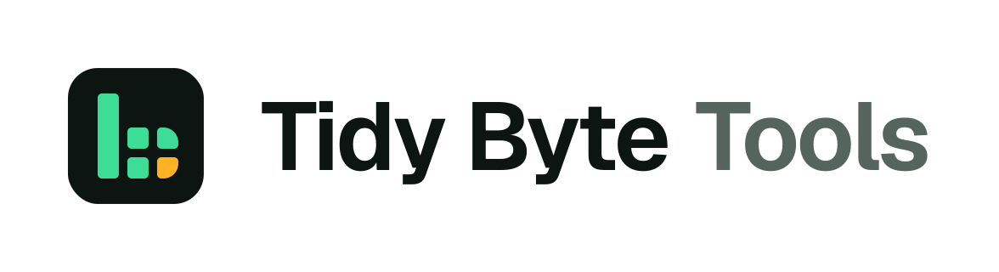
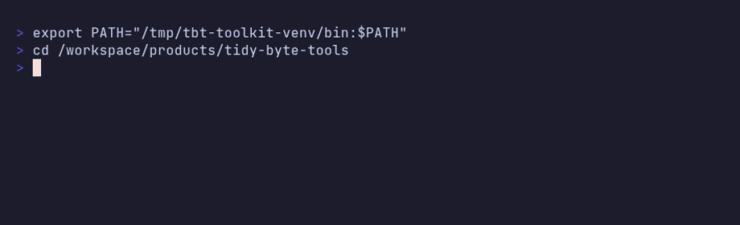

<p>
  <a href="https://github.com/tidybytetools">
    <picture>
      <source media="(prefers-color-scheme: dark)" srcset="https://raw.githubusercontent.com/tidybytetools/json-repair-lite/main/assets/tidybytetools-lockup-dark.png">
      
    </picture>
  </a>
</p>

# json-repair-lite

[](https://github.com/tidybytetools/json-repair-lite/actions/workflows/tests.yml)
[](https://github.com/tidybytetools/json-repair-lite/blob/main/LICENSE)
[](https://github.com/tidybytetools/json-repair-lite/releases)
[](https://apify.com/tidybytetools/json-repair)

Free tool that repairs broken or incomplete JSON, including output from language models. Runs offline. No API key.

## Example

Input (this is not valid JSON: unquoted keys, single quotes, and a trailing comma):

```
{name: 'Ada', ok: true, trailing: 'comma',}
```

Output from an actual run of `json-repair-lite`:

```json
{
  "name": "Ada",
  "ok": true,
  "trailing": "comma"
}
```

Already-valid JSON is left alone and reported honestly as `wasValid: true`.



Plain code, not AI, so the same input always gives the same output. Runs on your own computer. MIT license. Works with Python 3.10 and newer, on Windows, Mac and Linux.

Also searched as: ES: reparar JSON, JSON roto / PT: reparar JSON / DE: JSON reparieren / FR: réparer un JSON cassé / JA: 壊れたJSONを修復

## Links

- **[Apify (no-install cloud version)](https://apify.com/tidybytetools/json-repair)** — pay $0.001 per document; already-valid JSON is reported honestly

<!-- mcp-name: io.github.tidybytetools/json-repair-lite -->

## Install

```
pip install json-repair-lite
```

Or straight from GitHub: `pip install git+https://github.com/tidybytetools/json-repair-lite`

Or use pipx, which keeps it in its own space:

```
pipx install json-repair-lite
```

This also installs the [json-repair](https://pypi.org/project/json-repair/) library, which does the repair work, and the `mcp` package for the MCP server.

## Use it

```
printf "{name: 'Ada', ok: true,}" | json-repair-lite
json-repair-lite broken.json
json-repair-lite data.jsonl --json-lines
json-repair-lite broken.json --json     # {"ok": true, "count": 1, "failed": 0, "documents": [...]}
```

Without `--json-lines`, the whole text is tried as one JSON value first. If that cannot be repaired and there are several lines, each line is then tried on its own. With `--json-lines`, each non-empty line is its own document, and each result is printed as one line of JSON.

From Python:

```python
from json_repair_lite import repair_one
repair_one("{name: 'Ada',}")["value"]  # {'name': 'Ada'}
```

When you run it in a terminal it prints one short line about the Apify version to stderr after the result. It never goes into your JSON output, it only shows when you are looking at a terminal, and `--quiet` turns it off.

## Known limits

- **This is a repair step, not a language model.** It can close missing brackets and fix common syntax issues. It cannot invent the data you meant to write.
- **Some text cannot be repaired.** Those runs exit with an error.
- **Local files only.** This free tool does not fetch file links from the internet. The Apify version does.
- **5 MB cap in the MCP file tool.** The command line will read a larger local file, but very large jobs are a better fit for Apify.

## Lite vs Apify

| | lite (free, this repo) | [Apify cloud version](https://apify.com/tidybytetools/json-repair) |
|---|---|---|
| Repair broken or incomplete JSON | yes, on your computer | yes, in the cloud |
| JSON Lines | yes | yes |
| Fetch file links | no | yes |
| Many documents in one run | yes, from one file or stdin | yes, including file links |
| MCP server for local AI apps | yes | use Apify MCP for the cloud tool |
| Price | free | $0.001 per document, including JSON that was already valid. Empty input is free |

## Use it from Claude Desktop or Cursor (MCP)

There is a small free MCP server built in. It gives your AI app two tools. Both only read. They never write or change files, and they never use the internet. It needs [uv](https://docs.astral.sh/uv/).

Run it by hand to check it starts (it waits quietly for an app to talk to it):

```
uvx json-repair-lite mcp
```

Claude Desktop (`claude_desktop_config.json`) or Cursor (`~/.cursor/mcp.json`):

```json
{
  "mcpServers": {
    "json-repair-lite": {
      "command": "uvx",
      "args": ["json-repair-lite", "mcp"]
    }
  }
}
```

`uvx --from json-repair-lite json-repair-lite-mcp` starts the same server.

Tools:

- `repair_json_text(text, json_lines=false)`: for JSON in the chat.
- `repair_json_file(path, json_lines=false)`: for a local `.json` or `.jsonl` file, up to 5 MB.

For one document, both return `{"wasValid", "repaired", "value", "text"}`. For several documents, they return `{"count", "failed", "documents": [...]}`.

## For AI agents

- **Use when:** you have JSON that may be missing quotes, have trailing commas, or be cut off, including output from a language model.
- **Don't use when:** you need to fetch a file from a URL, or the file is bigger than 5 MB in MCP. Use the Apify version for those jobs. Do not use it to invent missing data.
- **Input:** text on stdin or a file path. Optional `--json-lines`.
- **MCP:** `uvx json-repair-lite mcp` gives two read-only tools, `repair_json_text` and `repair_json_file`.
- **Output:** with `--json`, one object: `{"ok": true, "count": 1, "failed": 0, "documents": [...]}`. On error `ok` is false. Exit code 0 ok, 1 error.
- Hint lines go to stderr only, and only in a terminal, so stdout is always clean JSON. See also [`llms.txt`](https://github.com/tidybytetools/json-repair-lite/blob/main/llms.txt).

## Tests

```
pip install "mcp>=1.10,<2" "json-repair>=0.64.9,<1"
python3 -m unittest discover tests
```

The MCP tests are skipped if `mcp` is not installed.

## FAQ

**What input does it take?**
One JSON value, or several JSON Lines. Text on stdin, or a local file.

**Do my files leave my computer?**
No. The tool runs on your computer and never uses the internet.

**Do you call an AI model?**
No. The repair runs offline.

**How is this different from the Apify version?**
The Apify version runs in the cloud, can fetch file links, and is built for many documents in one run. This lite tool is free and local.

**Does it work with AI apps?**
Yes. It includes a free MCP server. No API key.

## License

MIT. See `LICENSE`.
